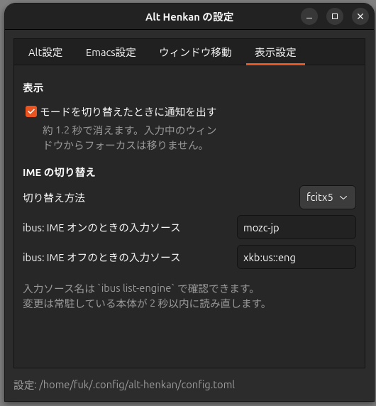
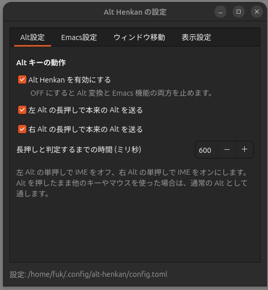
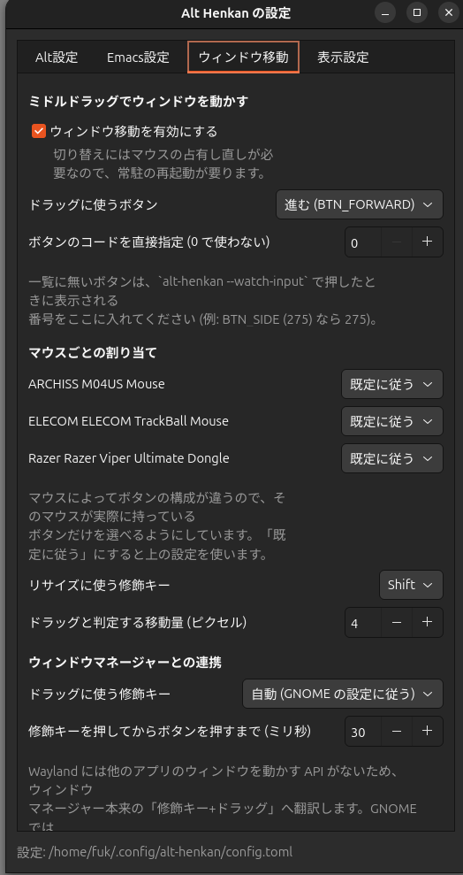
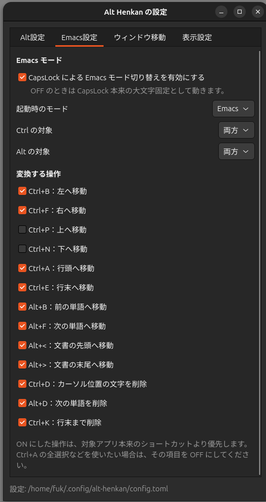

# Alt Henkan (Linux 版)

Alt Henkan は、左右の Alt キーを単独で押したときに追加の役割を与える常駐プログラムです。
Windows 版 ([alt-henkan](https://github.com/fukuyori/alt-henkan)) の入力変換ロジックを Linux へ
移植し、ミドルドラッグでウィンドウを動かす [wmv](https://github.com/fukuyori/wmv) の機能も
取り込んでいます。

- 左 Alt を単押し: IME をオフにする
- 右 Alt を単押し: IME をオンにする
- Alt を単独で長押しして離す: その側で有効にしていれば、本来の Alt 単独操作を実行する
- Alt を押したまま他のキーを押す、またはマウスのボタン・ホイールを使う: 通常の Alt との組み合わせをそのまま通す

長押し動作は左右の Alt で個別に有効・無効を切り替えられます。しきい値の既定値は 600 ミリ秒です。

さらに、マウスのミドルドラッグでウィンドウを移動できます (既定では OFF)。

- ミドルドラッグ: カーソル直下のウィンドウを移動する
- Shift + ミドルドラッグ: ウィンドウをリサイズする
- 動かさずに離す: 本来のミドルクリックを対象アプリへ送り直す

## 動作環境

- Linux (X11 / Wayland のどちらでも動作します)
- fcitx5 または ibus
- Rust 1.85 以降 (ソースからビルドする場合)
- GTK 4 (設定ウィンドウ。ビルドには `libgtk-4-dev` が必要)
- 通知領域のアイコンを使う場合は、GNOME では AppIndicator 系の拡張機能

## 仕組みと Windows 版との違い

Windows 版は `SetWindowsHookEx` の低レベルフックでキー入力を横取りし、`VK_IME_ON` /
`VK_IME_OFF` を送って IME を切り替えていました。Linux にはどちらも相当するものがありません。

| | Windows 版 | Linux 版 |
|---|---|---|
| 入力の横取り | 低レベルキーボードフック | evdev (`/dev/input/event*`) を `EVIOCGRAB` で占有 |
| 入力の送出 | `SendInput` | `/dev/uinput` の仮想キーボード |
| IME の切り替え | `VK_IME_ON` / `VK_IME_OFF` | fcitx5 の D-Bus、または ibus の入力ソース切り替え |
| 通知領域 | NotifyIcon | StatusNotifierItem (GNOME では AppIndicator 拡張が必要) |
| ウィンドウ移動 | `SetWindowPos` | ウィンドウマネージャーの「修飾キー+ドラッグ」へ翻訳 |
| 設定画面 | 設定ウィンドウ | GTK 4 の設定ウィンドウ (常駐する本体とは別プロセス) |
| モード表示 | 画面中央のオーバーレイ | デスクトップ通知 (`org.freedesktop.Notifications`) |

evdev の層で処理するため、ウィンドウマネージャーや表示サーバーに依存せず、Wayland でも
X11 でも同じように動作します。キー変換のロジック自体は Windows 版と同じ判断をします。

## インストール

```sh
./dist/install.sh
```

このスクリプトは次の作業をします。sudo を使うのは権限設定の部分だけで、常駐プロセス自体は
通常権限で動きます。

1. `cargo build --release` でビルドし、`~/.local/bin/alt-henkan` へ配置する
2. `/etc/udev/rules.d/99-alt-henkan.rules` を置き、`/dev/uinput` を `input` グループに開放する
3. `uinput` モジュールを読み込み、起動時にも読み込むようにする
4. ユーザーを `input` グループへ追加する
5. `~/.config/alt-henkan/config.toml` が無ければ作る
6. `~/.config/systemd/user/alt-henkan.service` を置いて有効化する

`input` グループへの追加が初回に行われた場合は、一度ログアウトして入り直してください。
その後、次のコマンドで起動します。

```sh
systemctl --user start alt-henkan.service
systemctl --user status alt-henkan.service
journalctl --user -u alt-henkan.service -f
```

削除は `./dist/uninstall.sh` です。

### IME の設定

`[ime]` の `backend` で切り替え方法を選びます。`--test-ime` で実際に切り替わるか
確認できます。設定ウィンドウの `表示設定` タブからも選べます。



```sh
alt-henkan --test-ime
```

#### ibus を使う場合

`backend = "ibus"` にすると、`ibus engine <名前>` で入力ソースを切り替えます。
GNOME で Super+Space を押したときと同じ操作なので、セッション側の設定を変えずに
そのまま使えます。

```toml
[ime]
backend = "ibus"
ibus-engine-on = "mozc-jp"
ibus-engine-off = "xkb:us::eng"
```

入力ソース名は `ibus list-engine` で確認できます。GNOME の「設定 → キーボード →
入力ソース」に登録してあるものを指定してください。

#### fcitx5 を使う場合

`backend = "fcitx5"` (既定) にすると、D-Bus の
`org.fcitx.Fcitx.Controller1` の `Activate` / `Deactivate` を呼びます。

```sh
sudo apt install fcitx5 fcitx5-mozc fcitx5-config-qt
./dist/setup-fcitx5.sh     # ログインし直すと有効
```

**`im-config -n fcitx5` だけでは GNOME Wayland で有効になりません。**
Ubuntu の im-config は Wayland セッションで何もしない作りになっていて
(`/etc/profile.d/im-config_wayland.sh` の中身が丸ごとコメントアウトされている)、
GNOME が自分の入力ソース設定に従って ibus を起動し直すため、再起動するたびに
ibus へ戻ります。`dist/setup-fcitx5.sh` は次の 3 つを直接設定します。

1. GNOME の入力ソースから ibus のものを外す (gnome-shell が ibus を起動しなくなる)
2. `~/.config/environment.d/60-im-fcitx5.conf` で `GTK_IM_MODULE` などを固定する
3. `~/.config/autostart/` に fcitx5 を登録する

元に戻すには `./dist/setup-fcitx5.sh --revert` を実行します。ログインし直したあと、
`echo $XMODIFIERS` が `@im=fcitx` になり、`fcitx5-remote` が `1` か `2` を返せば
成功です。`fcitx5-configtool` で「日本語 - Mozc」を入力メソッドに追加してください。

なお GNOME (Mutter) は Wayland の input-method プロトコル (`zwp_input_method_v2`) に
対応していないため、fcitx5 は GTK / Qt の入力モジュールと、Xwayland アプリ向けの XIM
経由で動きます。ほとんどの GTK・Qt アプリでは使えますが、一部のアプリでは日本語入力が
できません。そのままの環境で確実に動かしたい場合は `backend = "ibus"` を選んでください。

## 使い方

常駐すると通知領域にアイコンが出ます。アイコンをクリックするか、メニューの `設定...`
を選ぶと設定ウィンドウが開きます。アプリ一覧の「Alt Henkan の設定」からも開けます。

メニューには次の項目があります。

| 項目 | 内容 |
|---|---|
| 有効 | Alt 変換と Emacs 機能の両方を止める / 再開する (設定ファイルにも保存) |
| Emacsモード | 今のモードを切り替える (CapsLock と同じ。現在のモードは保存しません) |
| 設定... | 設定ウィンドウを開く |
| 終了 | 常駐を終了する |

設定ウィンドウは `Alt設定`・`Emacs設定`・`ウィンドウ移動`・`表示設定` の 4 タブで、
変更するとその場で保存します。常駐している本体が 2 秒以内に読み直すので、再起動は不要です。



設定ファイル (`~/.config/alt-henkan/config.toml`) を直接編集しても構いません。
書き戻すときはコメントと並びを保つので、説明を書き足しても消えません。設定項目の
説明は [`dist/config.example.toml`](dist/config.example.toml) にあります。

```sh
alt-henkan --print-config      # 読み込んでいる設定を表示する
alt-henkan --write-config      # 設定ファイルを既定値で作る
alt-henkan --list-devices      # 占有するキーボードと監視するポインターを一覧表示する
alt-henkan --watch-input       # 押したキー・ボタンの名前をその場で表示する
alt-henkan --test-ime          # IME のオフ・オンを実際に送って確認する
alt-henkan --diagnostics       # 処理の内容を標準エラーへ記録しながら動かす
```

### ウィンドウ移動

`[window-move]` の `enabled` を `true` にすると、マウスのミドルドラッグでウィンドウを
動かせます。ON / OFF の切り替えにはマウスの占有し直しが必要なので、常駐の再起動が要ります。

```sh
systemctl --user restart alt-henkan.service
```

| 操作 | 動作 |
|---|---|
| ドラッグ | カーソル直下のウィンドウを移動する |
| Shift + ドラッグ | ウィンドウをリサイズする |
| しきい値 (既定 4px) を超えずに離す | 本来のクリックを送り直す |

使うボタンは `button` で選べます (既定は中ボタン)。



| 値 | ボタン |
|---|---|
| `middle` | 中ボタン (既定) |
| `right` | 右ボタン |
| `side` / `extra` / `forward` / `back` / `task` | マウスの追加ボタン |
| `btn0` | BTN_0 |

一覧に無いボタンは `button-code` に生のコードを入れます。`alt-henkan --watch-input`
で押したときに出る番号をそのまま指定できます (例: `BTN_SIDE (275)` なら `275`)。
`button-code` は `button` より優先します。左ボタンは操作不能になるため使えません
(指定しても中ボタンに戻します)。

#### マウスごとに違うボタンを使う

ボタンの構成はマウスによって違うので、台ごとに割り当てを変えられます。設定ウィンドウの
「ウィンドウ移動」タブには、つながっているマウスが 1 行ずつ並び、**そのマウスが実際に
持っているボタンだけ**が選択肢に出ます。「既定に従う」にすると上の `button` を使います。

設定ファイルで書く場合は次のようにします。`name` はデバイス名の一部で、大文字小文字は
区別しません。前から順に、最初に一致したものを使います。デバイス名は
`alt-henkan --list-devices` で確認できます。

```toml
[window-move]
button = "middle"          # どのマウスにも使う既定

[[window-move.devices]]
name = "ELECOM"            # トラックボールだけ「進む」ボタン
button = "forward"

[[window-move.devices]]
name = "Razer"             # 名前の無いボタンはコードで指定できる
button-code = 275
```

起動時に、どのマウスがどのボタンを使うかをログに出します。

```text
ウィンドウ移動: ELECOM ELECOM TrackBall Mouse は BTN_FORWARD (277) でドラッグします
ウィンドウ移動: Razer Razer Viper Ultimate Dongle は BTN_SIDE (275) でドラッグします
```

Wayland には他のアプリのウィンドウを動かす API がありません。代わりに、ウィンドウ
マネージャーが元々持っている「修飾キー+ドラッグ」へ翻訳します。GNOME では
`org.gnome.desktop.wm.preferences` の `mouse-button-modifier` (既定は `<Alt>`) を
押しながら左ドラッグで移動、中ドラッグでリサイズになるので、次のように置き換えます。

| 入力 | 送出 |
|---|---|
| ミドルドラッグ | 修飾キー + 左ドラッグ |
| Shift + ミドルドラッグ | 修飾キー + 中ドラッグ |

この方式なので、最大化の解除・画面端へのスナップ・最小サイズ・対象外ウィンドウの判定は、
すべてウィンドウマネージャー本来の処理がそのまま働きます。修飾キーは `wm-modifier` で
自動検出 (`auto`) か、`alt` / `super` の直接指定を選べます。リサイズ側の修飾キーは
`resize-modifier` で `shift` / `ctrl` / `alt` / `none` から選べます。

占有するのは相対座標のマウス・トラックボールだけです。タッチパッドやタブレットのような
絶対座標のデバイスには触れません。

#### カーソルの動きへの影響

占有したマウスのイベントは、元の `SYN_REPORT` の区切り (フレーム) をそのまま保って
書き戻します。X と Y の移動は 1 フレームにまとめたまま通すので、1 回の動きが 2 回に
割れることはありません。デバイスの巡回は専用スレッドで行い、入力を捌くループを
止めません。

手元の実測 (1 ミリ秒間隔で 1500 フレームを流した場合):

| 項目 | 実測 |
|---|---|
| 入力フレーム数 : 出力フレーム数 | 1.00 : 1.00 |
| 1 フレームあたりのイベント数 | 2.00 (REL_X + REL_Y) |
| 取りこぼし (SYN_DROPPED) | 0 |
| 往復の遅れ (中央値 / 95% / 最大) | 0.22 / 0.33 / 0.38 ミリ秒 |
| CPU 時間 | 1 フレームあたり約 20 マイクロ秒 |

遅れには測定側のポーリング (0.2 ミリ秒) が含まれるため、実際の上乗せはこれより小さい
値になります。

### Emacs モード

`[emacs]` の `enabled` を `true` にすると、CapsLock で通常モードと Emacs モードを
切り替えます。機能は初期状態では OFF です。`initial-mode` で起動時のモードを選べます
(既定は `normal`)。CapsLock で切り替えた現在のモードは保存しません。機能を OFF にすると
通常モードに戻り、CapsLock 本来の大文字固定を使えます。機能を有効にして起動したとき、
大文字固定が ON なら解除します。

Emacs モードでも文字・数字・記号の入力は通常どおりです。次の 13 種類の移動・削除
ショートカットのみ変換し、それぞれを `[emacs.shortcuts]` で個別に ON / OFF できます
(各操作の既定値は ON)。



| キー | 操作（送信するキー） |
|---|---|
| Ctrl+B / Ctrl+F | 左 / 右 |
| Ctrl+P / Ctrl+N | 上 / 下 |
| Ctrl+A / Ctrl+E | Home / End（行頭 / 行末） |
| Alt+B / Alt+F | Ctrl+左 / Ctrl+右（前 / 次の単語） |
| Alt+< / Alt+> | Ctrl+Home / Ctrl+End（文書の先頭 / 末尾） |
| Ctrl+D | Delete（カーソル位置の文字を削除） |
| Alt+D | Ctrl+Delete（次の単語を削除） |
| Ctrl+K | Shift+End → Delete（行末まで削除。行末では改行を削除して次の行と結合） |

実際の移動・削除範囲は対象アプリの動作に従います。ON の操作は対象アプリ本来の
ショートカットより優先します。たとえば Ctrl+A の全選択、Ctrl+P の印刷、Ctrl+F の検索は
該当項目を OFF にすると使えます。Ctrl+V など上記以外のショートカットは変換しません。
vi モードは含みません。

US 配列の Alt+< は Alt+Shift+`,`、Alt+> は Alt+Shift+`.` です。この 2 種類は Shift を
必要としますが、その他の操作に Shift を追加した組み合わせや、Ctrl+Alt・Super キーを
追加した組み合わせは変換しません。

`control-side` / `alt-side` で、変換の対象にする修飾キーの側を `both` / `left` / `right`
から選べます。既定値は `both` で、左右どちらのキーでも使える意味です (同時押しは不要)。
`left` / `right` は指定した側が押されているときに変換し、対象外の側だけで押した操作は
通常どおり通します。この指定は Alt 単独の IME オン／オフや長押し設定には影響しません。

削除操作は切り取りではなく、クリップボードへ保存する処理や Emacs の kill ring は
実装しません。Ctrl+K は対象アプリの Shift+End で選択し、Delete で削除します。

Alt を使う上記の操作を実行した後に Alt を離しても、IME 切り替えを送りません。

## ビルドとテスト

```sh
cargo build --release                     # 常駐本体と設定ウィンドウの両方
cargo build --release --no-default-features --bin alt-henkan   # 本体だけ (GTK 不要)
cargo test
```

設定ウィンドウのビルドには `libgtk-4-dev` が必要です
(`sudo apt install libgtk-4-dev`)。GTK を使うのは `alt-henkan-settings` だけで、
常駐する本体には入りません。

deb パッケージは `./scripts/package.sh` で作れます (`dpkg-deb` が必要)。
`target/package/alt-henkan_<バージョン>_<アーキテクチャ>.deb` ができるので、
`sudo apt install ./target/package/alt-henkan_*.deb` で入れます。`dist/install.sh` と違って
`/usr` へ配置し、サービスの有効化は行いません。入れた後に表示される案内に従って
`systemctl --user enable --now alt-henkan.service` を実行してください。

入力変換のロジックは `src/engine.rs` に OS 呼び出しを含まない状態機械としてまとめてあり、
`tests/engine.rs` と `tests/window_move.rs` がキー入力・マウス操作の並びと出力を検証します。
実際のデバイスや uinput は使いません。

| ファイル | 役割 |
|---|---|
| `src/engine.rs` | 入力変換の状態機械 (Windows 版の `AltInputService` / `EmacsKeyboardState`) |
| `src/keys.rs` | evdev のキーコードと Emacs 変換表 |
| `src/config.rs` | 設定の読み書き |
| `src/devices.rs` | evdev デバイスの検出・占有と uinput への書き戻し |
| `src/ime.rs` | IME のオン・オフ (fcitx5 / ibus) |
| `src/notify.rs` | モード切り替えの通知 |
| `src/desktop.rs` | D-Bus 呼び出しを入力処理から切り離す作業スレッド |
| `src/message.rs` | 入力スレッドとトレイから本体へ渡すメッセージ |
| `src/tray.rs` | 通知領域のアイコンとメニュー |
| `src/window_move.rs` | ミドルドラッグによるウィンドウ移動 (Windows 版の `wmv`) |
| `src/settings.rs` | 設定ウィンドウ (GTK 4、別バイナリ) |

### どのボタンがどのコードか調べる

マウスの追加ボタンなどが、どのキーコードとして届いているかを確かめられます。
デバイスは占有しないので、押したものがそのまま対象アプリにも届きます。

```sh
systemctl --user stop alt-henkan.service
alt-henkan --watch-input
systemctl --user start alt-henkan.service
```

```text
ELECOM ELECOM TrackBall Mouse          BTN_SIDE (275)  押した
ELECOM ELECOM TrackBall Mouse          BTN_SIDE (275)  離した
ELECOM ELECOM TrackBall Mouse          REL_WHEEL (8)  +1
```

常駐したまま実行すると、占有しているデバイスのイベントは届きません (その旨を表示します)。
起動後に挿したデバイスも 1 秒ごとの巡回で拾います。

## 診断

Alt の操作が効かないときは `--diagnostics` を付けて動かし、左右の Alt を一度ずつ押して
出力を確認してください。Alt の処理、モード切り替え、Emacs 操作の種類が記録されます。
通常入力の文字は記録しません。

```sh
systemctl --user stop alt-henkan.service
~/.local/bin/alt-henkan --diagnostics
```

よくある原因:

- `/dev/uinput` を開けない — `ls -l /dev/uinput` が `crw-rw---- root input` になっているか、
  自分が `input` グループに入っているか (`id -nG`) を確認してください。グループを追加した
  直後はログインし直しが必要です。
- IME が切り替わらない — `alt-henkan --test-ime` を実行してください。fcitx5 なら
  `fcitx5-remote` が `1` か `2` を返すか、ibus なら `ibus engine` が入力ソース名を
  返すかを確認します。
- キーボードを検出できない — `alt-henkan --list-devices` で対象デバイスを確認してください。
- 通知領域にアイコンが出ない — GNOME では AppIndicator 系の拡張機能が必要です
  (`gnome-extensions list --enabled` に `ubuntu-appindicators` などがあるか確認)。
  アイコンが無くても常駐と変換は動き、設定ウィンドウはアプリ一覧から開けます。

## 制限事項

- IME の切り替えは fcitx5 と ibus に対応しています。他の入力メソッドは未対応です。
- GNOME Wayland では fcitx5 が Wayland の input-method プロトコルを使えないため、
  一部のアプリで日本語入力ができません (上記「fcitx5 を使う場合」を参照)。
- タッチパッドのタップによるクリックは libinput が evdev より上の層で合成するため、
  Alt を押したままタップしても通常の Alt に確定しません。物理ボタンのクリックとホイールは
  検出します。
- Alt を押したままマウスのボタンを押した場合、保留していた Alt の押下を送るのと、
  クリックがアプリへ届くのが別のデバイス経由になります。まれに順序が入れ替わることが
  あります。
- ウィンドウ移動が OFF のときに占有するのはキーボードだけです。マウスとタッチパッドは
  監視するだけで、入力は横取りしません。ON にすると相対座標のマウスも占有します。
- ウィンドウ移動はウィンドウマネージャーの「修飾キー+ドラッグ」に依存します。その仕組みを
  持たない環境では動きません。
- 常駐プロセスを強制終了すると、押したままの修飾キーが残ることがあります。仮想キーボードが
  消えた時点でコンポジターが解放するため、通常は自然に戻ります。

## ライセンス

[MIT License](LICENSE) です。
